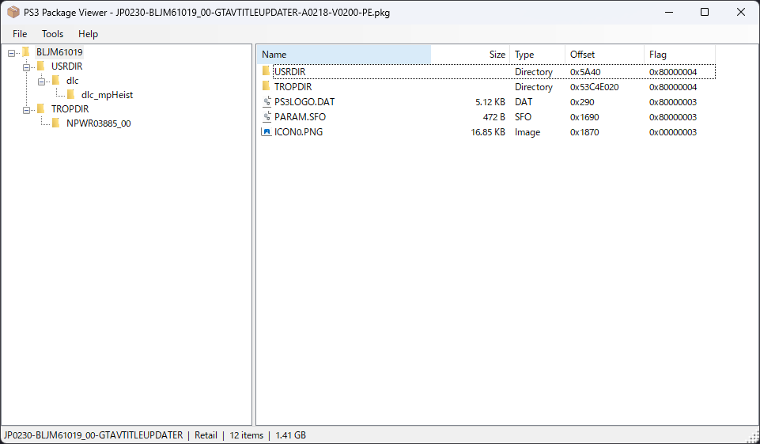

# PS3 Package Viewer

A PS3 Package Viewer and Extraction

**English** | [日本語](README.ja.md)

A Windows tool for opening PS3 PKG files, browsing their contents, and extracting them.



> [!NOTE]
> This tool only decrypts the outer encryption (AES-128-CTR) applied to the whole PKG.
> Extracted `EBOOT.BIN` and `*.self` files remain NPDRM SELF (encrypted executables).

## Features

- Open a PKG file and browse its folder tree and file list
  - Shows Name / Size / Type / Offset / Flag
  - Icons based on the file type
  - Double-click (or press Enter on) a folder to open it
- Extract the whole PKG (`Tools → Extraction`)
- Extract a single file or folder from the file list's context menu
- Extraction progress is shown in the status bar

### Supported PKG

| Type | revision | Status |
|---|---|---|
| PS3 Retail (Finalized) | `0x8000` | Supported |
| PS3 Debug (Non-finalized) | `0x0000` | Implemented, not yet verified |
| PSP / PS Vita | — | Not supported |

## Requirements

- Windows 10 / 11
- [.NET 10](https://dotnet.microsoft.com/) (Windows Desktop Runtime)

## Build

1. Open `PackageViewer.slnx` in Visual Studio
2. Restore NuGet packages (restored automatically on build)
3. Build and run

## Project structure

```
PackageViewer/
├── Extensions/
│   └── StreamExtensions.cs   … Big-endian read/write helpers (Stream extension methods)
├── IO/
│   ├── Decoder.cs            … PKG decryption (header and item table, AES-CTR / Debug keystream)
│   ├── FileEntry.cs          … A single entry in the item table (ItemRecord + decrypted file name)
│   ├── FileType.cs           … File type (EBOOT / SELF / Directory / Image, etc.)
│   ├── ItemRecord.cs         … PKG_ITEM_RECORD (0x20 bytes)
│   ├── PackageConstants.cs   … PKG format constants (signature, etc.)
│   ├── PackageHeader.cs      … Read/write the PKG header (0xC0 bytes)
│   └── Unpacker.cs           … Extraction to disk
├── Package.cs                … Decrypted package information
├── RuntimeHelpers.cs         … Application-wide helpers (app name, error dialog)
├── frmMain.cs                … Main window
└── frmAbout.cs               … About window
Resources/
├── appicon.ico
└── icon/                     … Icons for the file list
```

## PKG structure (overview)

| Range | Contents |
|---|---|
| `0x000`–`0x0BF` | Header (magic `\x7FPKG`, revision, type, data location, Content ID, IV, etc.) |
| `0x0C0`– | Metadata (DRM type, content type, etc.) |
| `data_offset`– | Encrypted data area (item table → file names → file data) |
| Last `0x20` bytes | SHA-1 of the whole file |

- All values are big-endian.
- Retail PKGs are encrypted with AES-CTR, using `AES-128-ECB(NPDRM PKG PS3 AES key, pkg_data_riv + block index)` as the keystream.
- See [PS3 Developer Wiki – PKG files](https://www.psdevwiki.com/ps3/PKG_files) for details.

## Roadmap

- [ ] Create new PKGs (Debug format for CFW)
- [ ] Replace files in an opened PKG

## Credits

- **[PS3 Developer Wiki](https://www.psdevwiki.com/ps3/)**
  - [PKG files](https://www.psdevwiki.com/ps3/PKG_files) — Specification of the PKG header, item records, metadata and encryption
- **[ByteSize](https://github.com/omar/ByteSize)** (ByteSizeLib) by Omar Khudeira — MIT License
  - Used for displaying file sizes

## License

[MIT License](LICENSE)

This software is provided "as is", without warranty of any kind. The author is not liable for any damages arising from its use.

---

© 2026 coreizer
